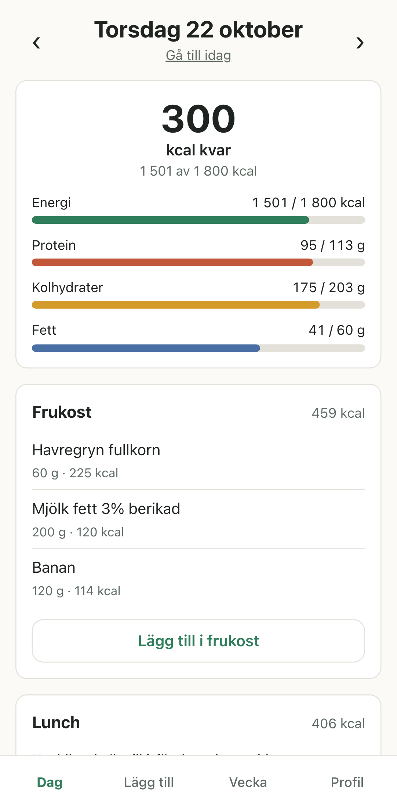
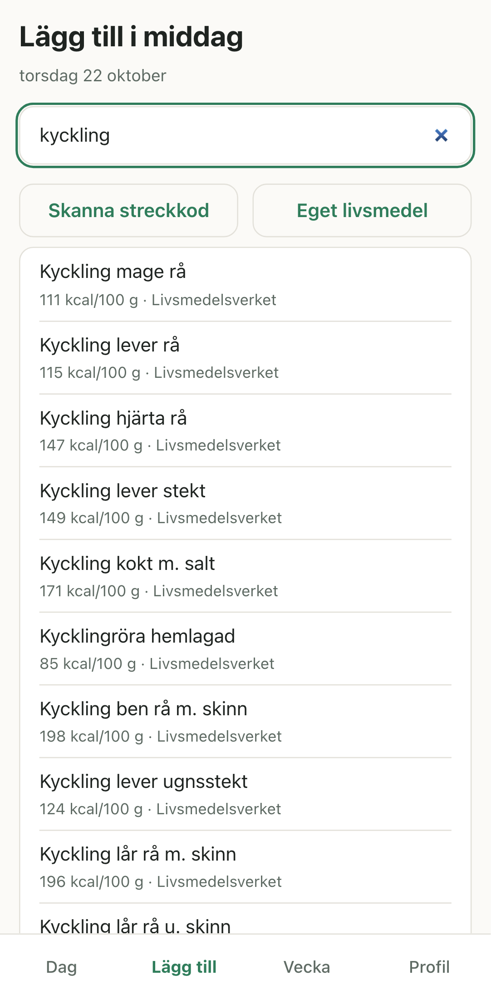
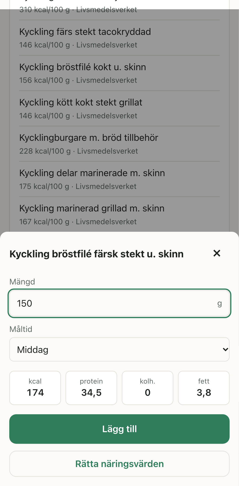
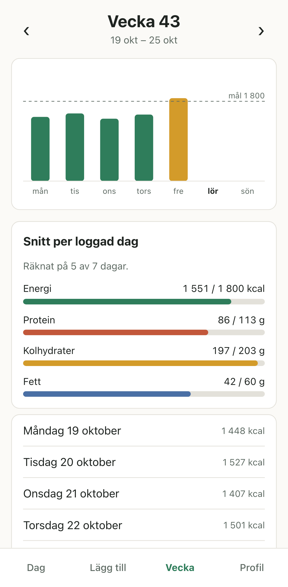
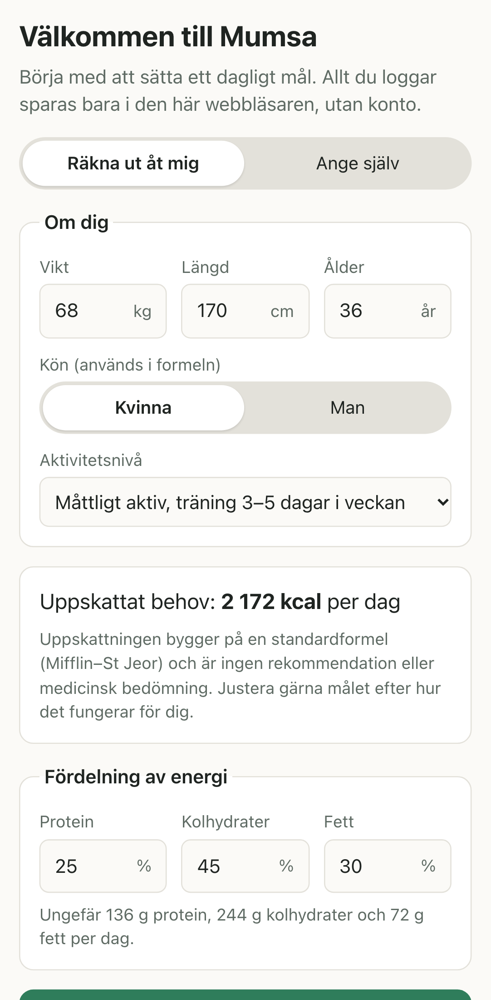
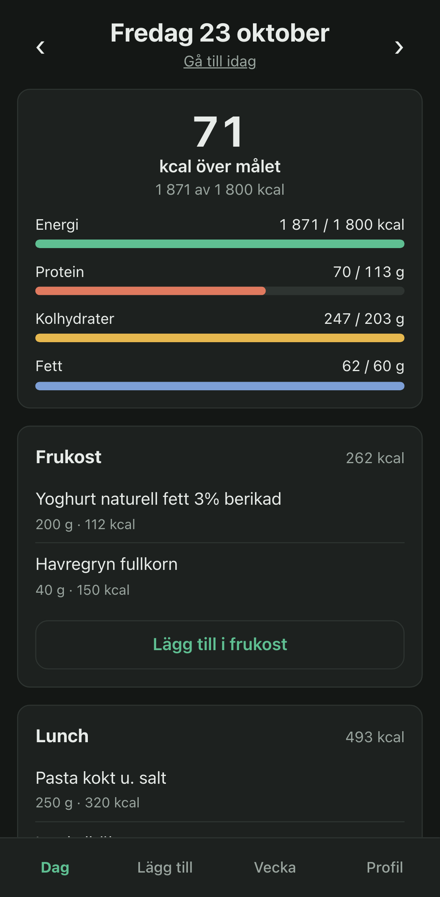

# Mumsa

En enkel och gratis matlogg för mobilen. Sätt ett dagligt mål, logga vad du äter per måltid och se hur dagen och veckan ligger till. Ingen inloggning, ingen reklam och ingen betalvägg. All data stannar på din enhet.

**Öppna appen:** https://tobiaso88.github.io/mumsa/

| Dag | Sök | Mängd | Vecka |
| --- | --- | --- | --- |
|  |  |  |  |

| Introduktion | Mörkt läge |
| --- | --- |
|  |  |

## Funktioner

- Kalorimål och fördelning av protein, kolhydrater och fett. Du anger målet själv eller låter appen uppskatta det utifrån vikt, längd, ålder och aktivitetsnivå. Uppskattningen är ingen rekommendation eller medicinsk bedömning.
- Sök bland cirka 2 600 livsmedel från Livsmedelsverket. Sökningen fungerar offline.
- Skanna streckkoder med kameran. Produkter hämtas från Open Food Facts.
- Egna livsmedel, och rättade kopior av livsmedel med fel värden.
- Logga i gram eller portioner, per frukost, lunch, middag och mellanmål.
- Dagsvy med intag mot målet och veckovy med diagram och snitt.
- Export och import av all data som JSON.
- Installeras som app på mobilen och fungerar offline.

## Så lagras din data

- Allt du loggar sparas i webbläsarens IndexedDB på din enhet. Det finns ingen server, inget konto och ingen synk mellan enheter.
- Livsmedelsverkets livsmedelsdatabas följer med appen som en fil. Sökningar skickas därför inte någonstans.
- Det enda nätverksanropet är uppslag av streckkoder hos Open Food Facts. Bara streckkoden skickas. Produkter som hämtats sparas lokalt och fungerar offline nästa gång.
- Om du rensar webbplatsdata i webbläsaren försvinner loggen. Under Profil → Inställningar kan du exportera en säkerhetskopia och be webbläsaren om beständig lagring.
- För att flytta till en ny enhet: exportera på den gamla och välj ”Importera en säkerhetskopia” på den nya.

## Installera på mobilen

- **iPhone:** öppna appen i Safari, tryck på Dela och välj *Lägg till på hemskärmen*.
- **Android:** öppna appen i Chrome och välj *Installera app* i menyn.

## Utveckling

Kräver Node 24.

```bash
npm install
```

| Kommando | Vad det gör |
| --- | --- |
| `npm run dev` | Startar utvecklingsservern |
| `npm run build` | Bygger till `dist/` |
| `npm test` | Kör enhetstester (Vitest) |
| `npm run e2e` | Kör end-to-end-tester (Playwright) mot det byggda resultatet |
| `npm run lint` | Kör ESLint och typkontroll |
| `npm run screenshots` | Tar om skärmdumparna i `docs/screenshots/` |
| `npm run icons` | Skapar appikonerna i `public/` |
| `npm run data:livsmedel` | Hämtar Livsmedelsverkets databas till `src/data/livsmedelsverket.json` |

Koden är uppdelad i tre lager: `src/domain/` (rena beräkningar), `src/data/` (IndexedDB, Open Food Facts, kamera och filer) och `src/ui/` (React). GitHub Actions kör lint och alla tester vid varje push och publicerar till GitHub Pages från `main`.

## Källor och licenser

- Livsmedelsverkets livsmedelsdatabas, licens [CC BY 4.0](https://creativecommons.org/licenses/by/4.0/deed.sv). Källa: Livsmedelsverket.
- Produktdata från [Open Food Facts](https://world.openfoodfacts.org), licens ODbL.
